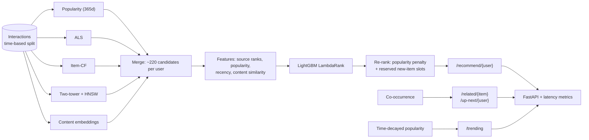

# Two-stage recommender for video games

A production-shaped recommender: five candidate generators, a LightGBM ranker, popularity-bias re-ranking, and a FastAPI service with latency metrics, experiment tracking and drift monitoring. Built on Amazon Reviews 2023 (Video Games), evaluated with a strict time-based split.

## Headline results (final test period, never used for tuning)

- The ranker beats the 365-day popularity baseline by **+23% Recall@10** (95% CI +14% to +32%) on 30,000 held-out users.
- Reserving 2 of 10 slots for new games gives **+25.6%** (95% CI +17% to +35%), raises catalog coverage from 0.0003 (popularity) to 0.16, and lifts Recall@10 on never-seen games from 0.0001 to 0.0081, with no measurable recall cost.
- Development (validation period) lift was +73%. The drop on the test period is real; see [Limitations](#limitations-and-negative-results).
- Serving: 3.3 ms median / 3.8 ms p99 per recommendation in-process; the API reaches about 520 requests/s on a laptop with 4 workers.

<!-- test:START -->
|  | recall@10 | ci95_low | ci95_high | ndcg@10 | map@10 | coverage@10 | recall@10 new items |
|---|---|---|---|---|---|---|---|
| popularity (365d) | 0.0198 | 0.0185 | 0.0212 | 0.0119 | 0.0072 | 0.0003 | 0.0000 |
| als | 0.0123 | 0.0113 | 0.0135 | 0.0075 | 0.0048 | 0.0482 | 0.0000 |
| itemcf | 0.0055 | 0.0048 | 0.0063 | 0.0035 | 0.0023 | 0.7907 | 0.0000 |
| twotower | 0.0074 | 0.0066 | 0.0082 | 0.0045 | 0.0027 | 0.0144 | 0.0000 |
| content | 0.0068 | 0.0060 | 0.0076 | 0.0039 | 0.0025 | 0.6539 | 0.0057 |
| RANKER | 0.0243 | 0.0228 | 0.0259 | 0.0145 | 0.0092 | 0.1097 | 0.0001 |
| RANKER + 2 new-item slots | 0.0248 | 0.0233 | 0.0264 | 0.0146 | 0.0092 | 0.1618 | 0.0081 |
<!-- test:END -->

Recall@10 is the share of a user's held-out purchases found in their top 10; the `ci95` columns come from resampling users. Popularity coverage is tiny because it shows everyone the same list.

## Architecture



One API, one small model per surface:

| Surface | Endpoint | Model |
|---|---|---|
| Recommended for you | `/recommend/{user_id}` | 5 candidate sources, LightGBM ranker, re-rank |
| Frequently bought together | `/related/{item_id}` | Item-item co-occurrence with a popularity discount |
| Up next | `/up-next/{user_id}` | Co-occurrence from the user's last game |
| Trending | `/trending` | Exponentially time-decayed popularity (30-day half-life) |

Unknown users fall back to trending. A sequence model (GRU) was tried for "up next" and rejected, see below.

## Data and evaluation protocol

- Amazon Reviews 2023, Video Games: ratings of 4+ stars as positives, 3-core filter, 229,475 users and 42,325 games.
- Global time split: oldest 80% train, next 10% validation, newest 10% test. No shuffling, so the model never sees the future.
- Development numbers come from train to validation. The ranker is then **frozen**. For the final test, candidate sources and features are refit on train+validation history, the frozen ranker scores them, and the result is judged on the test period. The test period was run once.
- Metrics: Recall, NDCG and MAP at 10, catalog coverage, and Recall on games that did not exist in the history ("new items").

## Development results (validation period)

<!-- dev:START -->
|  | recall@10 | ndcg@10 | map@10 | coverage@10 | recall@10 new items |
|---|---|---|---|---|---|
| top10 of pop | 0.0197 | 0.0125 | 0.0079 | 0.0004 | 0.0000 |
| top10 of als | 0.0135 | 0.0085 | 0.0056 | 0.0424 | 0.0000 |
| top10 of itemcf | 0.0078 | 0.0048 | 0.0033 | 0.5270 | 0.0000 |
| top10 of twotower | 0.0114 | 0.0072 | 0.0047 | 0.0105 | 0.0000 |
| top10 of content | 0.0081 | 0.0044 | 0.0027 | 0.4432 | 0.0062 |
| RANKER (LightGBM) | 0.0340 | 0.0203 | 0.0132 | 0.0506 | 0.0000 |
<!-- dev:END -->

The candidate generators together contain only about 10% of what users later buy (the ceiling), so there is headroom in candidate generation as well as in ranking.

## What drives the ranker

Top features by SHAP (mean absolute contribution):

<!-- shap:START -->
| feature | mean |SHAP| | direction (+ = higher value raises score) |
|---|---|---|
| item_pop_recent | 1.04 | 0.6287 |
| content_sim | 0.1982 | 0.9760 |
| best_rank | 0.1129 | -0.9226 |
| item_age_days | 0.0860 | -0.3544 |
| rank_pop | 0.0851 | -0.6646 |
| rank_als | 0.0851 | -0.6871 |
| n_sources | 0.0827 | 0.8905 |
| item_pop | 0.0669 | -0.6522 |
| pop_gap | 0.0484 | -0.8100 |
| rank_twotower | 0.0368 | -0.1095 |
<!-- shap:END -->

Ablations (retrain without one source or feature group) on validation data:

<!-- ablations:START -->
|  | recall@10 | ndcg@10 | coverage@10 | recall change |
|---|---|---|---|---|
| full model | 0.0307 | 0.0181 | 0.0389 | 0.0000 |
| - source: pop | 0.0268 | 0.0161 | 0.0647 | -0.1264 |
| - source: als | 0.0311 | 0.0174 | 0.0463 | 0.0148 |
| - source: itemcf | 0.0316 | 0.0181 | 0.0303 | 0.0306 |
| - source: twotower | 0.0322 | 0.0183 | 0.0416 | 0.0485 |
| - source: content | 0.0320 | 0.0187 | 0.0314 | 0.0437 |
| - features: source ranks | 0.0296 | 0.0172 | 0.0305 | -0.0345 |
| - features: item popularity & age | 0.0274 | 0.0156 | 0.0637 | -0.1053 |
| - features: user activity | 0.0308 | 0.0179 | 0.0459 | 0.0044 |
| - features: content similarity | 0.0293 | 0.0175 | 0.0475 | -0.0452 |
<!-- ablations:END -->

Recent popularity and content similarity carry most of the signal. The ablations are single-seed and noisy, so small differences between sources should not be read as real.

## Responsible AI

- **Popularity bias.** Share of recommendations by popularity quintile, against what users actually bought:

<!-- bias:START -->
|  | pop | als | itemcf | twotower | content | RANKER | actual (validation) |
|---|---|---|---|---|---|---|---|
| Q1 least popular | 0.0000 | 0.0000 | 0.0018 | 0.0000 | 0.1509 | 0.0003 | 0.3373 |
| Q2 | 0.0000 | 0.0000 | 0.3807 | 0.0000 | 0.1569 | 0.0039 | 0.0727 |
| Q3 | 0.0000 | 0.0000 | 0.1834 | 0.0000 | 0.1665 | 0.0035 | 0.0523 |
| Q4 | 0.0000 | 0.0000 | 0.1302 | 0.0000 | 0.1972 | 0.0086 | 0.1061 |
| Q5 most popular | 1.00 | 1.00 | 0.3038 | 1.0000 | 0.3286 | 0.9837 | 0.4315 |
<!-- bias:END -->

- **Exposure and new items.** On its own the ranker almost never shows a game that nobody has bought yet. A re-ranker applies a popularity penalty (lambda) and can reserve slots for new items:

<!-- rerank:START -->
| new_slots | lambda | recall@10 | ndcg@10 | coverage@10 | top20%_share | bottom20%_share | top1%_share | new_item_recall |
|---|---|---|---|---|---|---|---|---|
| 0 | 0.0000 | 0.0340 | 0.0203 | 0.0506 | 0.9837 | 0.0003 | 0.6444 | 0.0000 |
| 0 | 0.5000 | 0.0241 | 0.0138 | 0.2237 | 0.4883 | 0.3675 | 0.1292 | 0.0116 |
| 0 | 1.00 | 0.0137 | 0.0076 | 0.2770 | 0.2080 | 0.5422 | 0.0177 | 0.0157 |
| 2 | 0.0000 | 0.0334 | 0.0201 | 0.1194 | 0.8164 | 0.1602 | 0.5499 | 0.0068 |
| 2 | 0.5000 | 0.0238 | 0.0137 | 0.2239 | 0.4834 | 0.3727 | 0.1280 | 0.0116 |
| 2 | 1.00 | 0.0137 | 0.0076 | 0.2770 | 0.2080 | 0.5422 | 0.0177 | 0.0157 |
<!-- rerank:END -->

On validation data, 2 reserved new-item slots cost 1.8% of recall for 2.4x the catalog coverage, and moved the share of recommendations going to the top 1% most popular games from 64.4% to 55.0%. On the test period the same setting had no measurable recall cost.

## Production shape

- **API:** FastAPI with typed responses, input validation, an `X-Process-Time-Ms` header on every response, and `/metrics` with per-endpoint p50/p95/p99 and error counts.
- **Training/serving skew test:** a unit test checks that the features the API builds at request time equal the features used in training.
- **Approximate search:** FAISS HNSW for the two-tower source, at efSearch=64 it is about 7x faster than exact search on the real catalog (91% top-100 overlap with the exact results) and about 234x faster in a synthetic 1M-item test.
- **Serving latency** (single request, in-process, per stage):

<!-- serving:START -->
|  | p50 ms | p95 ms | p99 ms | max RPS (1 core) |
|---|---|---|---|---|
| 1_candidate_sources_ms | 2.18 | 2.45 | 2.55 | – |
| 2_features_ms | 0.3155 | 0.3946 | 0.4549 | – |
| 3_ranker_ms | 0.5678 | 0.6356 | 0.6638 | – |
| 4_rerank_ms | 0.2112 | 0.2457 | 0.2728 | – |
| total_ms | 3.32 | 3.66 | 3.84 | 301 |
| related() | 0.0750 | 0.0820 | 0.0858 | – |
| up_next() | 0.0959 | 0.1017 | 0.1047 | – |
| trending() | 0.0764 | 0.0798 | 0.0820 | – |
<!-- serving:END -->

- **Load test** (closed loop, mixed endpoints, laptop):

<!-- load:START -->
| setup | concurrency | requests | rps | p50_ms | p95_ms | p99_ms | error_rate |
|---|---|---|---|---|---|---|---|
| 1 worker | 1 | 2183 | 218 | 6.25 | 7.49 | 8.42 | 0.0000 |
| 1 worker | 8 | 3276 | 327 | 27.62 | 39.85 | 58.14 | 0.0000 |
| 1 worker | 32 | 2676 | 265 | 108 | 262 | 501 | 0.0000 |
| 4 workers | 1 | 1734 | 173 | 6.64 | 12.36 | 20.50 | 0.0000 |
| 4 workers | 8 | 5233 | 523 | 11.66 | 39.75 | 51.58 | 0.0000 |
| 4 workers | 32 | 2863 | 284 | 62.02 | 360 | 588 | 0.0000 |
<!-- load:END -->

- **Experiment tracking:** MLflow logs parameters, metrics and artifacts for ranker training and the final evaluation.
- **Drift monitoring:** PSI on input features, current period against the ranker's training cutoff:

<!-- drift:START -->
| feature | psi | status | ref_mean | cur_mean |
|---|---|---|---|---|
| user_last_days | 0.0947 | ok | 1,277 | 1,536 |
| user_n_hist | 0.0442 | ok | 4.64 | 4.83 |
| user_n_recent | 0.0215 | ok | 0.5097 | 0.3679 |
| item_pop_recent | 0.0185 | ok | 3.10 | 2.10 |
| item_age_days | 0.0089 | ok | 2,572 | 2,737 |
| item_pop | 0.0032 | ok | 28.21 | 27.51 |
| user_avg_log_pop | 0.0016 | ok | 4.69 | 4.66 |
<!-- drift:END -->

- **Quality:** unit tests and `ruff` run in GitHub Actions on every pull request; each phase was merged by pull request.
- **Config and packaging:** settings come from environment variables (`.env.example`); a Makefile wraps common tasks; a Dockerfile builds a slim serving image (written, **not yet built or tested**).

## Other surfaces

<!-- together:START -->
|  | recall@10 | ndcg@10 | coverage@10 | recall (niche anchor) | recall (mid anchor) | recall (popular anchor) | anchors with a full real list |
|---|---|---|---|---|---|---|---|
| popularity (same list for every game) | 0.0230 | 0.0141 | 0.0004 | 0.0192 | 0.0218 | 0.0279 | – |
| co-occurrence alpha=0.0 | 0.0186 | 0.0115 | 0.1287 | 0.0192 | 0.0170 | 0.0198 | 0.6918 |
| co-occurrence alpha=0.5 | 0.0141 | 0.0080 | 0.2462 | 0.0193 | 0.0108 | 0.0122 | 0.6918 |
| co-occurrence alpha=0.75 | 0.0112 | 0.0060 | 0.2798 | 0.0191 | 0.0099 | 0.0045 | 0.6918 |
| co-occurrence alpha=1.0 | 0.0095 | 0.0052 | 0.2878 | 0.0189 | 0.0080 | 0.0016 | 0.6918 |
<!-- together:END -->

## Limitations and negative results

- **The test lift is smaller than the development lift** (+23% against +73%). The most likely cause is that the frozen ranker was trained about 21 months before the test period and recent activity per item fell in between; I have not yet run the experiment that would confirm this.
- **The recommender still depends heavily on popularity.** Its features are dominated by recent item popularity, and without reserved slots it shows almost no new games.
- **"Up next" has thin data for niche games.** Co-occurrence has nothing for rare anchors, so about 31% of anchor games lack a full list of real co-occurrence neighbours and are padded with trending items.
- **Co-occurrence does not beat popularity on recall.** For "bought together", popularity reaches Recall@10 of 0.0230 against 0.0186 for co-occurrence. Recall rewards recommending popular games; co-occurrence is kept for relevance to the anchor game and for coverage (see the table above), not for recall.
- **A GRU sequence model was worse than the co-occurrence baseline** and was rejected:

<!-- seq:START -->
|  | recall@10 | ndcg@10 | coverage@10 | recall (short history) | recall (mid history) | recall (long history) |
|---|---|---|---|---|---|---|
| popularity (pop_365d) | 0.0230 | 0.0141 | 0.0004 | 0.0217 | 0.0264 | 0.0208 |
| last game -> co-occurrence (7a) | 0.0186 | 0.0115 | 0.1287 | 0.0209 | 0.0181 | 0.0169 |
| GRU over last games (7b) | 0.0138 | 0.0084 | 0.0083 | 0.0151 | 0.0139 | 0.0126 |
<!-- seq:END -->

- **Offline only.** There are no online tests, so these numbers say nothing about click-through or satisfaction.
- **Low absolute recall** (about 2.4%) reflects a hard setting: 42,000 games, short histories, and users who buy few games in any period.
- Candidate-source ablations are single-seed; the Docker image has not been built; the load test ran on one laptop with the load generator on the same machine.

## Reproduce

```bash
make install                      # dependencies + editable install
make check                        # ruff + tests
# data (see scripts/): prepare, build dataset and items, embed items
python scripts/run_candidates.py && python scripts/run_ranker.py
python scripts/run_analysis.py && python scripts/run_rerank.py
python scripts/build_artifacts.py && make serve          # API on :8000
python scripts/run_final.py       # final test evaluation (about 15 min)
make app                          # Streamlit demo
python scripts/make_report.py     # refresh the tables in this file
```

## Layout

```
src/recsys/   data, baselines, candidates, ranker, analysis, rerank, cooc, ann, serve, api,
              tracking, monitoring, evalstats, report, demo
scripts/      one script per experiment or tool
tests/        unit tests (CI runs them)
reports/      CSVs and plots produced by the scripts
docs/         offline evaluation report
app/          Streamlit demo
```